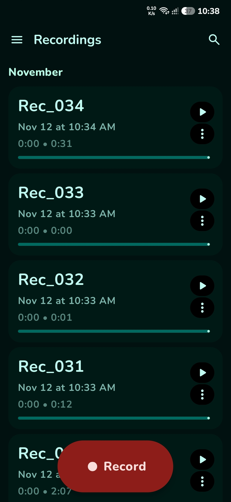
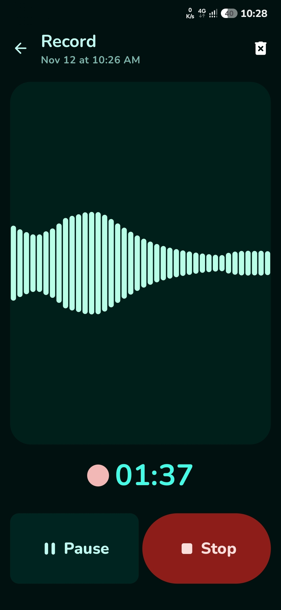
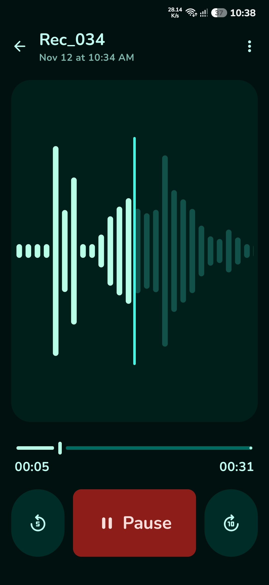
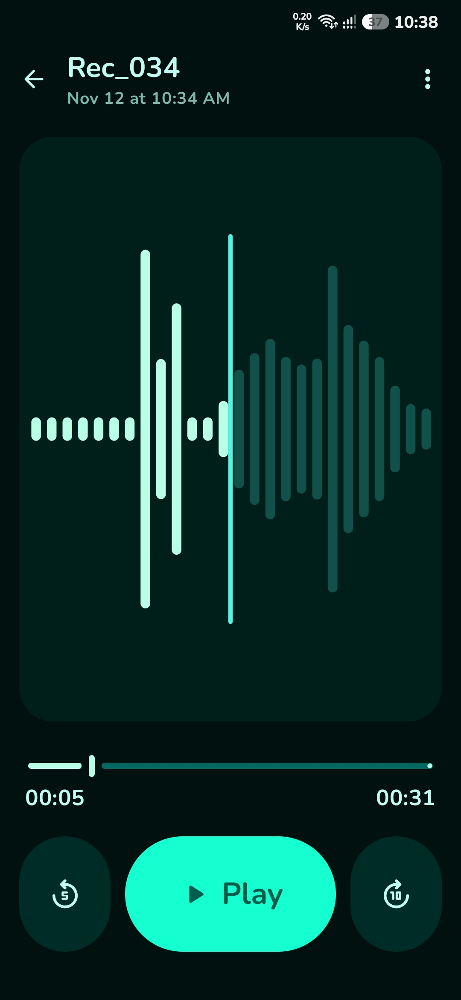
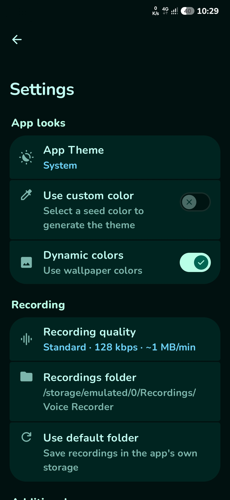
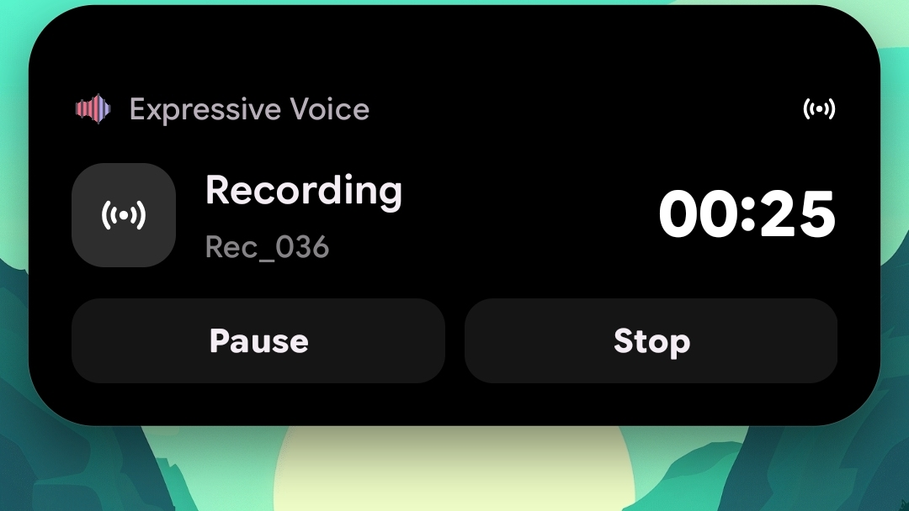
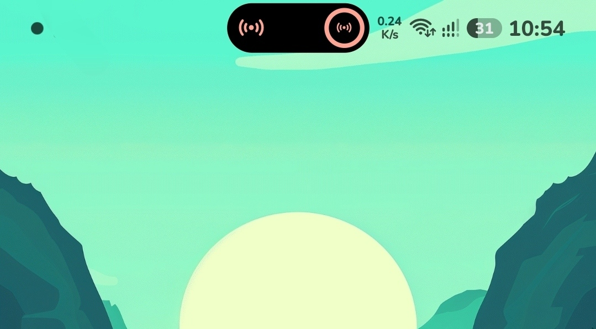

   

<h1 align="center">
   Expressive Voice
</h1>

 

  

 

[Contact](#️-contact) • [License](#️-license)

 

       

   <h3>Expressive Voice: a Material 3 Expressive voice recorder, inspired by the Google Pixel Recorder app</h3>

   

 
   

 

# 👁️ Screenshots

<table align="center">
  <tr>
    <td align="center"></td>
    <td align="center"></td>
    <td align="center"></td>
  </tr>
  <tr>
    <td align="center"></td>
    <td align="center"></td>
    <td align="center">
        
      
    </td>
  </tr>
</table>

 

# 📝 What's new in 2.6

- Long-press the app icon to start recording right away; also available to Shortcut Maker, KWGT and Tasker.

## 2.5

- Live recording notification with Pause/Resume and Stop, and recording that continues in the background.
- Update checker fixed.

## 2.0

- Recording quality setting (Low / Standard / High / Maximum).
- Choose where recordings are saved.
- One-tap recording from the home screen, with a pill-shaped Record button and haptic feedback.
- Scrubbing the progress bar shows the exact time you are at.
- Wiki Reader-style grouped settings.
- Faster lists and faster opening of recordings.

Shows as **Recorder** under the launcher icon. Package name: `com.captechomar.recorder`.

# 🙏 Credits

Expressive Voice is a fork of [RecordMaster](https://github.com/PranshulGG/RecordMaster) by PranshulGG and contributors.

# ✉️ Contact

For any questions or feedback, feel free to open an issue on GitHub or contact omar.ashraf1md@gmail.com

# ©️ License

This project is licensed under the GPL-3.0 license. See the `LICENSE` file for details.
